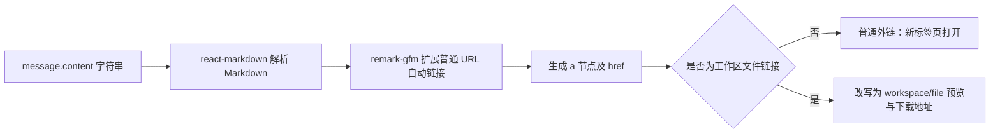
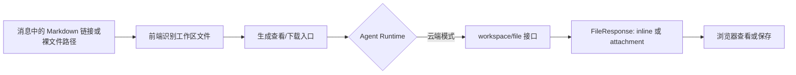

# Web 前端消息渲染

## 消息内容如何渲染

### 1 数据进入组件

桌面端会话消息模型的核心字段是：

```ts
interface Message {
  id: string;
  role: 'user' | 'assistant' | 'system';
  content: string;
  thinking?: string;
  thinkingLog?: string[];
  executionSteps?: ExecutionStep[];
  workflowMermaid?: string;
  references?: Reference[];
  timestamp: number;
}
```

历史消息由 `hydrateSession()` 将后端持久化消息转成前端 `Message`。流式对话时，`ApiService.streamChat()` 读取 SSE；每收到一个 `content` 事件，就把 `data.content` 追加到 `fullText`，再通过 `onChunk` 更新当前 assistant 消息。因此流式回复每次更新都会触发 React 重新解析和渲染当前累计 Markdown。

相关位置：

- `frontend/types.ts:135-150`
- `frontend/services/api.ts:52-72`
- `frontend/services/api.ts:633-704`

### 2 Markdown 渲染主链路

桌面端在 `ChatArea` 中遍历 `session.messages`，将 `m.content` 交给：

```tsx
<ReactMarkdown
  remarkPlugins={[remarkGfm]}
  components={MarkdownComponents}
>
  {m.content || typingPlaceholder}
</ReactMarkdown>
```


渲染分工如下：

| 层 | 职责 |
| --- | --- |
| `react-markdown` | 把 Markdown 文本解析成语法树，并转换成 React 元素 |
| `remark-gfm` | 支持 GFM 表格、删除线、任务列表、普通 URL/邮箱自动链接等扩展语法 |
| `MarkdownComponents` | 覆盖 `a`、`img`、`code` 等节点的最终 React 渲染方式 |
| `.markdown-body` CSS | 控制标题、段落、列表、代码块、表格、引用、链接和图片样式 |

桌面端位置：`frontend/components/ChatArea.tsx:492-563, 631-641`。

当前没有配置 `rehype-raw`，因此消息中的原始 HTML 不会作为可执行 HTML 直接渲染。这也避免了把模型输出中的 `<script>` 或事件属性直接注入页面。

### 3 普通链接如何被识别

普通链接的识别主要发生在 Markdown 解析阶段，不是 `ChatArea` 自己扫描字符串。

支持的典型形式包括：

```md
[OpenAI](https://openai.com)
<https://openai.com>
https://openai.com
www.example.com
```

- 第一种、第二种由标准 Markdown 链接/自动链接语法识别。
- 后两种由 `remark-gfm` 的 literal autolink 能力识别。
- 识别完成后，解析器产生 `a` 节点，自定义 `a({ href, children })` 组件收到最终 `href`。
- 普通链接最终使用 `target="_blank"` 和 `rel="noopener noreferrer"` 在新标签页打开。

因此，“链接识别”和“链接分类”是两个阶段：



### 4 工作区文件链接如何被识别

工作区文件链接有一套额外的业务规则。`isWorkspaceFileLink(href)` 会调用 `normalizeWorkspacePath(href)`：

1. 去掉首尾尖括号和末尾常见标点。
2. 排除 `http:`、`https:`、`data:`、`mailto:` 和 `#` 开头的地址。
3. 仅接受以下路径形态之一：
   - 绝对路径：`/...`
   - `output/` 或 `outputs/` 下的路径
   - `upload/` 或 `uploads/` 下的路径
   - `.claude/skills/<技能名>/output/` 下的路径
4. 文件扩展名必须是：`md`、`pdf`、`csv`、`xls`、`xlsx`、`html`、`htm`、`txt`、`json`、`png`、`jpg`、`jpeg`、`gif`、`webp`、`svg`。

命中后，桌面端会把链接改写为：

```text
GET /api/v1/workspace/file?path=<path>&session_id=<session>
GET /api/v1/workspace/file?path=<path>&download=true&filename=<name>&session_id=<session>
```

第一个用于预览/打开，第二个用于下载。

相关位置：

- 桌面规则：`frontend/components/ChatArea.tsx:9-81`
- 桌面链接组件：`frontend/components/ChatArea.tsx:526-561`
- URL 构造：`frontend/services/api.ts:4-20`

需要注意：仅仅在消息中出现一个普通本地路径，并不会让 Markdown 解析器把它变成正文中的 `a` 节点；但后续“生成文件”扫描器会识别符合规则的裸路径，并在消息下方额外生成文件卡片。

### 5 图片、生成文件和特殊代码渲染

图片：

- `http://`、`https://`、`data:` 图片地址直接作为 `src`。
- 本地/工作区图片路径通过 workspace file API 转成预览地址。
- 图片外层有链接，点击后在新标签页查看原图。

生成文件：

- 从 Markdown 文件链接、正文中的裸文件路径、`thinking` 和 `thinkingLog` 中的“生成文件/保存到/导出到”等提示提取路径。
- 使用 `Map` 按路径去重。
- 图片文件额外显示缩略图；其他文件显示打开和下载按钮。

内联代码：

- 桌面端若内联 `code` 内容包含 `@`，会尝试按技能名匹配技能，并显示技能图标和标签样式。
- 其他代码块交给默认 Markdown code/pre 节点和 `.markdown-body` 样式处理。

### 6 查看与下载文件的完整链路

“查看/下载文件”不是单一步骤，而是由以下三层共同完成：



#### 6.1 从消息中解析文件

文件可能以两种方式出现在消息里。

第一种是 Markdown 文件链接：

```md
[查看报告](outputs/report.pdf)
```

`react-markdown` 先把它解析成带有 `href="outputs/report.pdf"` 的 `a` 节点，之后自定义 `a` 组件调用 `isWorkspaceFileLink()` 判断是否属于工作区文件。判断规则见 3.4 节。

第二种是消息中的裸文件路径：

```text
文件已生成：outputs/report.pdf
```

裸路径通常不会被 Markdown 解析成 `a` 节点，但 `extractGeneratedFiles()` 会分别扫描：

- `message.content` 中的 Markdown 文件链接；
- `message.content` 中符合扩展名和目录规则的裸文件路径；
- `message.thinking` 中“生成文件”“保存到”“导出到”等提示后的路径；
- `message.thinkingLog` 中相同形式的路径。

扫描结果使用 `Map` 按完整路径去重，最后在消息下方渲染“生成文件”卡片。图片卡片还会附带缩略图。

因此，正文链接和生成文件卡片是两条并行链路：正文链接依赖 Markdown 产生 `a` 节点；生成文件卡片可以识别没有 Markdown 语法的裸路径。

相关位置：

- 桌面端：`frontend/components/ChatArea.tsx:9-81, 526-561, 644-687`

#### 6.2 云端模式的查看与下载

云端模式下，查看和下载使用同一个工作区文件接口，只是查询参数不同。

查看：

```text
GET /api/v1/workspace/file
    ?path=outputs/report.pdf
    &session_id=<session-id>
```

下载：

```text
GET /api/v1/workspace/file
    ?path=outputs/report.pdf
    &session_id=<session-id>
    &download=true
    &filename=report.pdf
```

`getWorkspaceFileUrl()` 使用 `URLSearchParams` 对路径、文件名和会话 ID 编码，避免直接拼接未转义参数。前端根据入口类型决定是否添加 `download=true`。

后端 `GET /workspace/file` 的处理过程如下：

1. 通过登录态取得当前 `user_id`。
2. 如果提供 `session_id`，先确认该会话存在且属于当前用户。
3. 校验 `session_id` 只包含字母、数字、下划线和连字符，长度为 1 至 64。
4. 将传入路径解析到 `.eido/workspaces/<session_id>/` 会话目录下。
5. 使用 `Path.resolve()` 和 `relative_to(session_root)` 检查最终路径，阻止 `../`、绝对路径或符号链接造成的目录越界。
6. 检查目标存在且是普通文件。
7. 使用 FastAPI/Starlette `FileResponse` 返回文件。

查看和下载的核心区别是响应的 `Content-Disposition`：

```python
content_disposition_type="attachment" if download else "inline"
```

- `inline`：告诉浏览器尽量在页面中直接展示。
- `attachment`：告诉浏览器把文件作为附件保存，下载文件名来自 `filename` 参数或原文件名。

后端只为 PNG、JPEG、GIF、WebP 和 SVG 显式设置 MIME 类型；其他类型交给 `FileResponse`/系统 MIME 推断。最终是否能够预览由浏览器能力和响应 MIME 类型共同决定：

| 文件类型 | 查看时的常见行为 |
| --- | --- |
| PNG/JPEG/GIF/WebP/SVG | 浏览器直接显示；消息卡片中的图片还可通过 `` 内嵌 |
| PDF | 通常使用浏览器内置 PDF 阅读器 |
| TXT/CSV/Markdown/JSON | 通常显示为文本，具体取决于 MIME 推断 |
| HTML | `inline` 时通常作为网页加载 |
| XLS/XLSX | 浏览器通常不具备原生预览能力，可能直接下载或交给外部应用 |
| 未识别类型 | 通常作为二进制文件下载或显示失败 |

换言之，云端 Eido 不会自行解析 PDF、Excel 或 Markdown 的内容来生成专用阅读器；它负责鉴权、安全解析路径和返回文件，实际查看由浏览器完成。

相关位置：

- URL 构造：`frontend/services/api.ts:4-20`
- 工作区文件接口：`backend/app/api/v1/endpoints/workspace.py:28-97`
- 会话路径安全解析：`backend/app/services/chat/session_workspace.py:19-29, 61-89`
